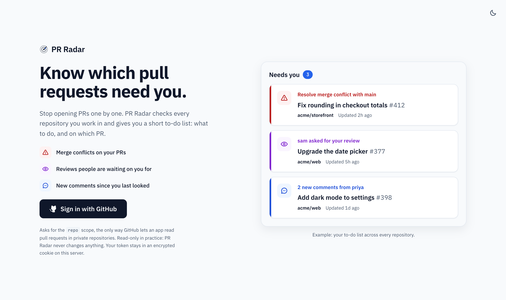

# PR Radar

Sign in with GitHub and get a to-do list of the pull requests that need you, across every repository you work in. No more opening PRs one by one to see if something changed.

<picture>
  <source media="(prefers-color-scheme: dark)" srcset="docs/landing-dark.png">
  
</picture>

## What it shows

- **Needs you**: a short list that says what to do and on which PR:
  - **Resolve merge conflict** (on PRs you author or are assigned to)
  - **Review requested** (someone is waiting on your review, including via your teams)
  - **Address requested changes** (on PRs you author or are assigned to)
  - **New comments** from other people since you last looked
- **Everything else**: the rest of your open PRs, with their status: failing checks, unresolved threads, behind base, approved, ready to merge, draft.
- **Projects sidebar**: pick a repository to see only its PRs. The selection is in the URL, so you can bookmark it.

It covers PRs you **authored**, are **assigned** to, are **asked to review**, or have **already reviewed**. Use the status chips, the **Show** menu and search (press <kbd>/</kbd>) to filter. Light and dark themes included.

## Running it locally

Requires Node.js 20.9 or newer.

1. **Create a GitHub OAuth App** at <https://github.com/settings/applications/new>
   - Homepage URL: `http://localhost:3001`
   - Authorization callback URL: `http://localhost:3001/api/auth/callback`
   - Then generate a client secret.
2. **Configure it:**
   ```sh
   cp .env.example .env.local
   # fill in GITHUB_CLIENT_ID and GITHUB_CLIENT_SECRET, then:
   echo "SESSION_SECRET=$(openssl rand -base64 32)" >> .env.local
   ```
3. **Run it:**
   ```sh
   npm install
   npm run dev
   ```
   Open <http://localhost:3001> and sign in.

### Organization repos not showing up?

Many organizations restrict OAuth apps. On the GitHub sign-in screen, click **Grant** (or **Request**) next to the organization. You can also do this later at <https://github.com/settings/applications> → PR Radar. If an org uses SAML SSO, authorize the app for SSO there too. The dashboard shows a yellow banner when GitHub refuses to return some repositories.

## How "new comments" works

A comment or review counts as new if someone else posted it **after the later of**:
- the last time you opened that PR from the dashboard (or clicked *Mark read*), and
- your own last comment or review on that PR.

So replying on GitHub clears it automatically. Bot comments (CI, Linear, AI reviewers) are ignored unless you tick **Count bot comments**.

## Privacy

- PR Radar only **reads** from GitHub. It never comments, merges or changes anything.
- There is no database. Your GitHub token lives in an AES-256-GCM encrypted, httpOnly cookie that browser JavaScript can't read, and is only sent to GitHub's API.
- Read/unread state, filters and your theme are kept in your own browser's localStorage.
- It asks for GitHub's `repo` scope because that is the only way an OAuth App can read pull requests in private repositories.

## How it works

- `app/api/auth/*`: the GitHub OAuth flow and the encrypted session cookie.
- `lib/github.ts`: four cheap GraphQL searches find your PR IDs, then each unique PR's details are fetched in small parallel batches. One refresh costs a few points of GitHub's 5,000/hour budget.
- `lib/signals.ts`: turns raw PR data into the "Needs you" tasks and the status badges.
- `components/`: the UI. The dashboard refreshes every 2 minutes and whenever you return to the tab. GitHub computes merge conflicts lazily, so a PR may briefly show *Checking for conflicts…* and then update on its own.

Built with Next.js, React and TypeScript.

## Deploying it for everyone

The env vars configure the site itself, not any one user. You set them once on the server; visitors just click **Sign in with GitHub** and each sees only their own PRs, using their own token and their own GitHub API quota.

1. Create a **second** OAuth App for production. An OAuth App has exactly one callback URL, so keep the localhost one for development.
   - Homepage URL: `https://your-domain`
   - Callback URL: `https://your-domain/api/auth/callback`
2. Deploy to any Node host. Vercel is the simplest for Next.js: import the repo, then add the env vars in *Settings → Environment Variables*:
   `GITHUB_CLIENT_ID`, `GITHUB_CLIENT_SECRET` (from the production OAuth App), `SESSION_SECRET` (a new random value), and `APP_URL=https://your-domain`.
3. Redeploy so the variables take effect.

Never commit `.env.local`; it's already in `.gitignore`.

## License

[MIT](LICENSE) © Chowdhury Zaber Bin Zahid
